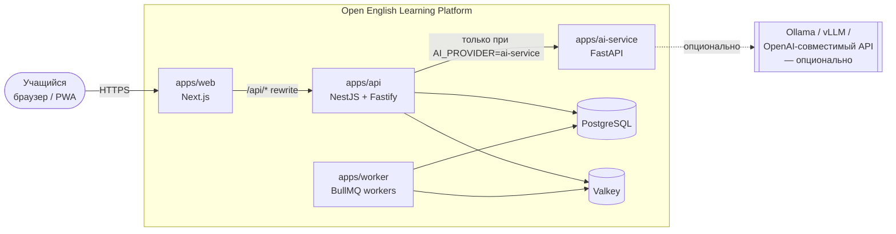
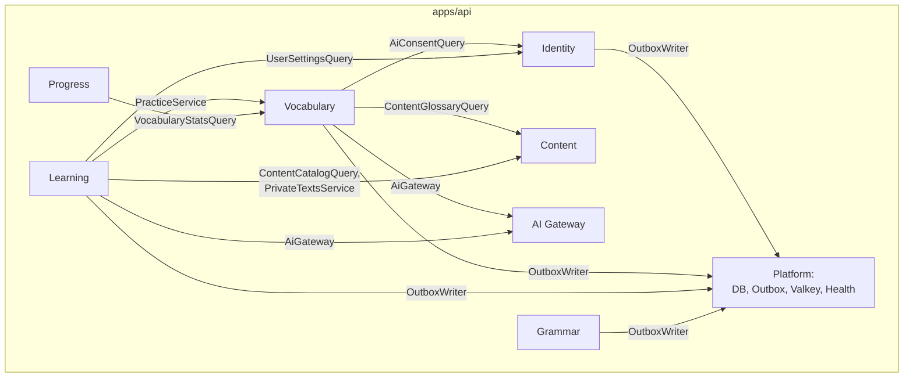
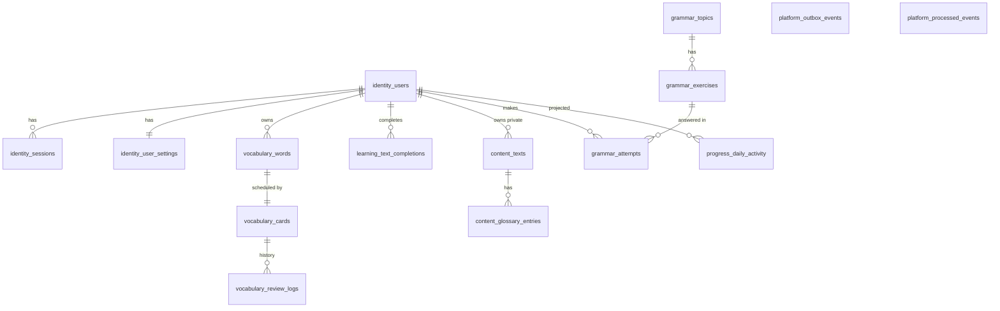
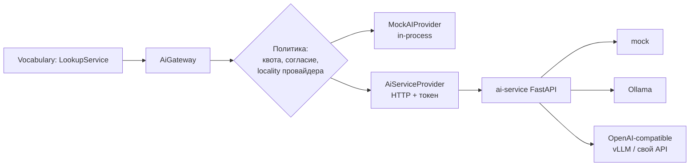
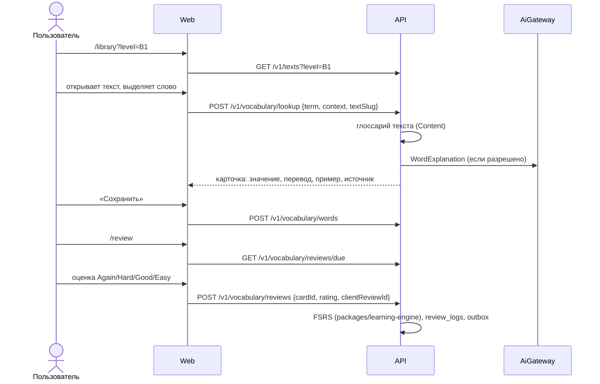

# Архитектура Open English Learning Platform

> Рабочее название проекта — **Open English Learning Platform** (репозиторий `LingoUp`, npm-scope `@lingoup/*`).
> Документ описывает целевую архитектуру и фактическое состояние реализации. Всё, что ещё не реализовано, явно помечено.

## 1. Архитектурный стиль

**Modular Monolith + Event-Driven Architecture + Independent AI Services.**

| Принцип                                        | Как реализован                                                                                                                                                                                         |
| ---------------------------------------------- | ------------------------------------------------------------------------------------------------------------------------------------------------------------------------------------------------------ |
| Модульный backend со строгими границами        | Модули NestJS в `apps/api/src/modules/*`, каждый со своим публичным API (`index.ts`) и собственной PostgreSQL-схемой. Границы проверяются архитектурным тестом (`apps/api/test/architecture.test.ts`). |
| Минимальная связанность                        | Модули общаются через публичные сервисы (синхронно) или через доменные события (асинхронно). Прямой доступ к чужим таблицам запрещён.                                                                  |
| Постепенное выделение в микросервисы           | У каждого модуля своя схема БД, свои события и контракты в `packages/contracts`. Модуль можно вынести, заменив in-process вызовы на HTTP и сохранив события.                                           |
| Независимое масштабирование AI и фоновых задач | `apps/worker` и `apps/ai-service` — отдельные процессы и Docker-образы.                                                                                                                                |
| Stateless HTTP API                             | Состояние сессии хранится в PostgreSQL (opaque token), счётчики лимитов — в Valkey. Любой экземпляр API может обработать любой запрос.                                                                 |
| Асинхронная обработка тяжёлых операций         | Transactional Outbox → BullMQ → идемпотентные обработчики в `apps/worker`.                                                                                                                             |
| Self-hosted-first                              | Всё запускается через Docker Compose без внешних платных сервисов. AI по умолчанию — `MockAIProvider`, GPU не нужен.                                                                                   |

Сознательно **не используются** на первом этапе: микросервисы, Kubernetes, Kafka, отдельные БД на модуль, service mesh. Обоснование — в [ADR-0001](docs/adr/0001-modular-monolith.md).

## 2. Контекст системы



## 3. Контейнеры и процессы

| Процесс      | Назначение                                                                                                                                       | Масштабирование                                          |
| ------------ | ------------------------------------------------------------------------------------------------------------------------------------------------ | -------------------------------------------------------- |
| `web`        | UI на Next.js (App Router). Проксирует `/api/*` на API, чтобы cookie были same-origin.                                                           | Горизонтально, без состояния                             |
| `api`        | REST API, OpenAPI, авторизация, синхронная бизнес-логика, запись в outbox.                                                                       | Горизонтально, без состояния                             |
| `worker`     | Outbox relay (PostgreSQL → BullMQ) и обработчики событий (проекции прогресса).                                                                   | Горизонтально; relay использует `FOR UPDATE SKIP LOCKED` |
| `ai-service` | Python/FastAPI: адаптеры LLM (mock, Ollama, OpenAI-совместимый — подходит для vLLM и пользовательских API), валидация структурированного вывода. | Независимо, по нагрузке на inference                     |
| `postgres`   | Единственный источник истины. Образ `pgvector/pgvector` — расширение доступно, но пока не включено.                                              | Вертикально, далее реплики чтения                        |
| `valkey`     | Очереди BullMQ, rate limiting, AI-квоты. Данные в Valkey можно потерять без потери бизнес-данных.                                                | Вертикально / Sentinel                                   |
| `ollama`     | Опциональный локальный LLM (профиль Compose `ollama`).                                                                                           | GPU-узлы                                                 |

## 4. Модули backend



Стрелка означает: «вызывает публичный API модуля». Обратных зависимостей и циклов нет.

| Модуль         | Статус           | Ответственность                                                                                                                                                                                                               | Схема БД            |
| -------------- | ---------------- | ----------------------------------------------------------------------------------------------------------------------------------------------------------------------------------------------------------------------------- | ------------------- |
| **Identity**   | ✅ MVP           | Регистрация, вход, сессии, профиль, настройки (включая согласие на внешний AI)                                                                                                                                                | `identity`          |
| **Content**    | ✅ MVP           | Библиотека текстов, CEFR-метаданные, глоссарий, импорт из `content/`; личные AI-тексты пользователя (видны только владельцу)                                                                                                  | `content`           |
| **Vocabulary** | ✅ MVP           | Персональный словарь, контекст слова, FSRS-карточки, история повторений, lookup, упражнения с пропуском (AI или сохранённые примеры), картинки к словам                                                                       | `vocabulary`        |
| **Learning**   | 🟡 Частично      | Отметка о прочтении (`LessonCompleted`), генерация личных текстов из слов пользователя. Учебные сессии — позже                                                                                                                | `learning`          |
| **Grammar**    | ✅ MVP           | Темы по уровням: правило, примеры, упражнения (выбор и ввод) с проверкой на сервере и прогрессом. Импорт из `content/grammar/`                                                                                                | `grammar`           |
| **Progress**   | 🟡 Частично      | Проекция ежедневной активности (из событий), сводка профиля. Анализ слабых сторон — позже                                                                                                                                     | `progress`          |
| **AI Gateway** | 🟡 Частично      | Абстракция `AIProvider`, маршрутизация, таймауты (интерактивный и для генерации), лимит параллельности, retry, валидация вывода, квоты, приватность. Задачи: `WordExplanation`, `ReadingTextGeneration`, `ExerciseGeneration` | — (Valkey)          |
| **Assessment** | ⏳ Не реализован | Тестирование навыков, оценка уверенности в уровне                                                                                                                                                                             | `assessment` (план) |
| **Planner**    | ⏳ Не реализован | Цели, доступное время, адаптивный план                                                                                                                                                                                        | `planner` (план)    |
| **Media**      | ⏳ Не реализован | Видео, аудио, субтитры                                                                                                                                                                                                        | `media` (план)      |

### 4.1. Внутреннее устройство модуля

```text
modules/vocabulary/
├── domain/          # Чистые правила и инварианты. Без NestJS и БД.
├── application/     # Use cases (сервисы), порты (интерфейсы репозиториев).
├── infrastructure/  # Drizzle-репозитории и адаптеры.
├── http/            # Контроллеры, привязка контрактов к HTTP.
├── vocabulary.module.ts
└── index.ts         # Публичный API модуля — единственное, что можно импортировать извне.
```

Слои не догматичны: если use case тривиален, репозиторий-интерфейс не создаётся (см. правило «без ненужных абстракций»).

### 4.2. Правила границ (проверяются автоматически)

1. Файл модуля `X` может импортировать из модуля `Y` только `modules/Y/index.ts`.
2. Модуль `X` может импортировать Drizzle-схему только `@lingoup/database/schema/X` (и `platform` — только через `OutboxWriter`).
3. Пакеты в `packages/*` не импортируют приложения из `apps/*`.

Тест: `apps/api/test/architecture.test.ts`.

## 5. Владение данными

Одна база PostgreSQL, **отдельная схема на модуль**. Подробности — [ADR-0003](docs/adr/0003-postgres-schema-per-module.md).



| Схема        | Владелец                                | Таблицы                                          |
| ------------ | --------------------------------------- | ------------------------------------------------ |
| `identity`   | Identity                                | `users`, `sessions`, `user_settings`             |
| `content`    | Content                                 | `texts` (публичные и личные), `glossary_entries` |
| `grammar`    | Grammar                                 | `topics`, `exercises`, `attempts`                |
| `vocabulary` | Vocabulary                              | `words`, `cards`, `review_logs`, `word_images`   |
| `learning`   | Learning                                | `text_completions`                               |
| `progress`   | Progress (запись — обработчик в worker) | `daily_activity`                                 |
| `platform`   | Platform (инфраструктура)               | `outbox_events`, `processed_events`              |

Межсхемные внешние ключи разрешены **только на `identity.users(id)`** с `ON DELETE CASCADE`: это даёт целостное удаление персональных данных. Ссылки на контент (`source_text_id`) хранятся без FK: модуль контента может переехать, а снимок контекста (предложение, slug) сохраняется в словаре.

## 6. События

Каталог и версии — в `packages/contracts/src/events`. Конверт события:

```ts
{ id: uuid, type: "WordSaved", version: 1, occurredAt: ISO-8601, userId?: uuid, payload: {...} }
```

| Событие                     | Версия | Производитель       | Потребители | Статус                                |
| --------------------------- | ------ | ------------------- | ----------- | ------------------------------------- |
| `UserRegistered`            | 1      | Identity            | — (резерв)  | ✅ публикуется                        |
| `WordSaved`                 | 1      | Vocabulary          | Progress    | ✅                                    |
| `VocabularyReviewCompleted` | 1      | Vocabulary          | Progress    | ✅                                    |
| `LessonCompleted`           | 1      | Learning            | Progress    | ✅ (чтение текста)                    |
| `LessonStarted`             | 1      | Learning            | —           | 📄 контракт, не публикуется           |
| `ExerciseCompleted`         | 1      | Grammar, Vocabulary | Progress    | ✅ (грамматика, упражнение по словам) |
| `AssessmentCompleted`       | 1      | Assessment          | —           | 📄 контракт, не публикуется           |
| `SkillLevelUpdated`         | 1      | Progress            | —           | 📄 контракт, не публикуется           |
| `LearningPlanUpdated`       | 1      | Planner             | —           | 📄 контракт, не публикуется           |

### Transactional Outbox

```mermaid
sequenceDiagram
    participant C as Клиент
    participant API as API (Vocabulary)
    participant PG as PostgreSQL
    participant R as Worker: outbox relay
    participant Q as Valkey (BullMQ)
    participant H as Worker: обработчик Progress

    C->>API: POST /v1/vocabulary/words
    API->>PG: BEGIN; INSERT words, cards; INSERT outbox_events; COMMIT
    API-->>C: 201 Created
    loop каждые OUTBOX_POLL_INTERVAL_MS
        R->>PG: SELECT ... FOR UPDATE SKIP LOCKED (published_at IS NULL)
        R->>Q: add(job, jobId = event.id)
        R->>PG: UPDATE published_at = now()
    end
    Q->>H: job(WordSaved)
    H->>PG: BEGIN; INSERT processed_events (ON CONFLICT DO NOTHING); UPSERT daily_activity; COMMIT
```

- Гарантия доставки — **at-least-once**. Дубликаты отсекаются на двух уровнях: `jobId = event.id` в BullMQ и таблица `platform.processed_events` (ключ `consumer + event_id`) в одной транзакции с изменением проекции.
- Retry с экспоненциальным backoff настроен в BullMQ. После исчерпания попыток задача остаётся в failed-наборе для разбора.
- Синхронно выполняется всё, что нужно пользователю сразу (сохранение слова, расчёт FSRS). Через очередь идут только побочные эффекты (проекции, в будущем — генерация упражнений, уведомления).

## 7. AI-архитектура



- Контракты задач описаны в `packages/ai-sdk`. **Реализованы `WordExplanation`, `ReadingTextGeneration` (личный текст из слов пользователя) и `ExerciseGeneration` (предложения с пропуском)**; синтез речи реализован отдельно, см. ниже. `GrammarExplanation`, `WritingAssessment`, `SpeechRecognition`, `LearningRecommendation` — объявленные типы без исполнителя; Gateway честно отвечает `AI_TASK_NOT_SUPPORTED`.
- **Озвучка** (`SpeechGateway`, порт `SpeechProvider`): `AiServiceSpeechProvider` — голоса Microsoft Edge через ai-service (edge-tts, бесплатно), `AzureSpeechProvider` — Azure AI Speech напрямую из API. Аудио кэшируется в Valkey, квота общая с AI. Отдельное слово отправляется в Microsoft без согласия пользователя, предложение — только с согласием; без провайдера работает голос браузера. См. [ADR-0009](docs/adr/0009-pronunciation-azure-speech.md).
- Генерация выполняется синхронно в HTTP-запросе с отдельным таймаутом `AI_GENERATION_TIMEOUT_MS` и не повторяется при ошибке; если AI недоступен, упражнение по словам строится из сохранённых примеров. См. [ADR-0008](docs/adr/0008-grammar-and-ai-practice.md).
- `AiGateway` не знает о моделях: он выбирает провайдера по `AI_PROVIDER`, применяет таймаут (`AbortSignal.timeout`), семафор параллельности, retry только для идемпотентных задач, валидирует ответ Zod-схемой и считает дневную квоту пользователя в Valkey.
- **Приватность:** провайдер объявляет `dataLocality: "local" | "external"`. Пользовательский текст отправляется во внешний провайдер, только если администратор это разрешил (`AI_ALLOW_EXTERNAL=true`) **и** пользователь дал согласие (`user_settings.ai_data_sharing`). Иначе используется только глоссарий текста, без AI.
- AI-эндпоинты не публичны: требуется сессия, работает rate limit. ai-service принимает только запросы с `AI_SERVICE_TOKEN`.
- Streaming: **не реализован**. Он нужен для разговорной практики и развёрнутых объяснений; в `WordExplanation` не оправдан (ответ короткий и структурированный).

## 8. Сценарий MVP: Interactive Reading + Personal Vocabulary



Повторения идемпотентны: клиент передаёт `clientReviewId` (UUID), повторная отправка не создаёт второй записи.

## 9. Безопасность

| Требование          | Реализация                                                                                                                                                                                                           |
| ------------------- | -------------------------------------------------------------------------------------------------------------------------------------------------------------------------------------------------------------------- |
| Авторизация         | Email + пароль, хеш Argon2id (`@node-rs/argon2`). Opaque session token (256 бит) в `HttpOnly; SameSite=Lax` cookie, в БД хранится только SHA-256 токена.                                                             |
| CSRF                | `SameSite=Lax` и проверка `Origin` для всех изменяющих запросов (`ALLOWED_ORIGINS`).                                                                                                                                 |
| Права доступа       | Все запросы к пользовательским данным фильтруются по `user_id` из сессии на уровне репозитория.                                                                                                                      |
| Валидация           | Zod-схемы из `packages/contracts` на входе API; ответы AI тоже валидируются.                                                                                                                                         |
| Rate limiting       | `@nestjs/throttler` с хранилищем в Valkey; ключ — IP клиента (IPv6 группируется по /64), отдельные лимиты для auth и AI-lookup. Дополнительно: не более 10 неудачных входов за 15 минут на аккаунт независимо от IP. |
| Размер запросов     | `bodyLimit` Fastify (по умолчанию 64 КБ), ограничения длины полей в схемах.                                                                                                                                          |
| HTML/Markdown       | Тексты хранятся как простые абзацы; импорт отклоняет HTML. React рендерит только текстовые узлы, без `dangerouslySetInnerHTML`.                                                                                      |
| Логи                | Pino с `redact` для `authorization`, `cookie`, паролей и email. Тела запросов не логируются; из ошибок БД вырезаются значения параметров запроса (`toSafeError`).                                                    |
| Секреты             | Только переменные окружения; `.env` в `.gitignore`; в репозитории — `.env.example`. В production сервисы отказываются стартовать с плейсхолдерами `change-me`.                                                       |
| Контейнеры          | Непривилегированные пользователи, `no-new-privileges`, `cap_drop: ALL`; наружу опубликованы только порты на `127.0.0.1`.                                                                                             |
| Редиректы           | После входа разрешены только относительные пути того же origin (защита от open redirect).                                                                                                                            |
| Заголовки           | `@fastify/helmet` в API; заголовки безопасности в Next.js.                                                                                                                                                           |
| Health / shutdown   | `/health/live`, `/health/ready` (PostgreSQL + Valkey); `enableShutdownHooks` в API, обработка `SIGTERM` в worker.                                                                                                    |
| Персональные данные | `GET /v1/me/export` (JSON-экспорт) и `DELETE /v1/me` (каскадное удаление).                                                                                                                                           |

## 10. Технологический стек

| Слой                    | Технологии                                                                                      |
| ----------------------- | ----------------------------------------------------------------------------------------------- |
| Monorepo                | pnpm 12 workspaces, Turborepo 2                                                                 |
| Frontend                | Next.js 16, React 19, TypeScript 6, Tailwind CSS 4, TanStack Query 5                            |
| Backend                 | NestJS 12 (ESM), Fastify 5, Zod 4, OpenAPI (`@nestjs/swagger`)                                  |
| БД                      | PostgreSQL 18 (образ с pgvector), Drizzle ORM 0.45, drizzle-kit (версионированные SQL-миграции) |
| Очереди/кэш             | Valkey 9, BullMQ 6, ioredis 6                                                                   |
| Интервальные повторения | FSRS через `ts-fsrs` (MIT)                                                                      |
| AI                      | Python 3.14, FastAPI, Pydantic 2, httpx; Ollama (опционально)                                   |
| Качество                | ESLint 9 + typescript-eslint (strictTypeChecked), Prettier, Vitest 5, Playwright, Ruff, Pytest  |
| Инфраструктура          | Docker, Docker Compose, GitHub Actions                                                          |

Обоснование выбора версий — [ADR-0002](docs/adr/0002-technology-stack.md).

## 11. Наблюдаемость

- ✅ Структурированные JSON-логи (pino) с request id.
- ✅ Health checks.
- ⏳ OpenTelemetry (трейсы API → worker → ai-service) — запланировано, см. [ROADMAP.md](ROADMAP.md).
- ⏳ Prometheus / Grafana — каталог `infra/monitoring` зарезервирован.

## 12. Технический долг и ограничения MVP

Актуальный список — в [docs/architecture/tech-debt.md](docs/architecture/tech-debt.md).
