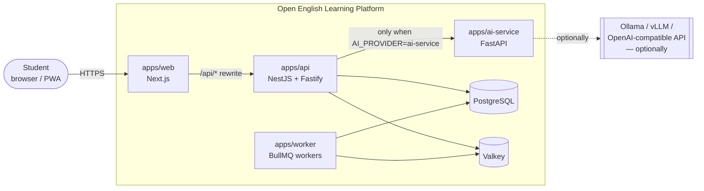
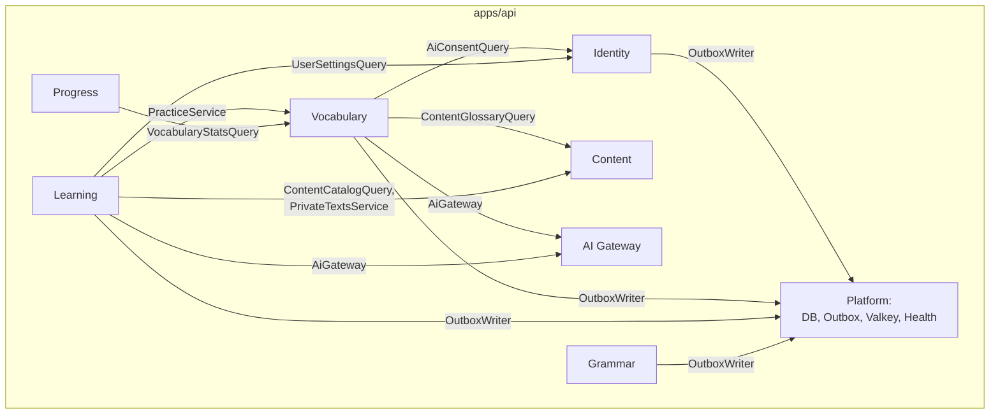
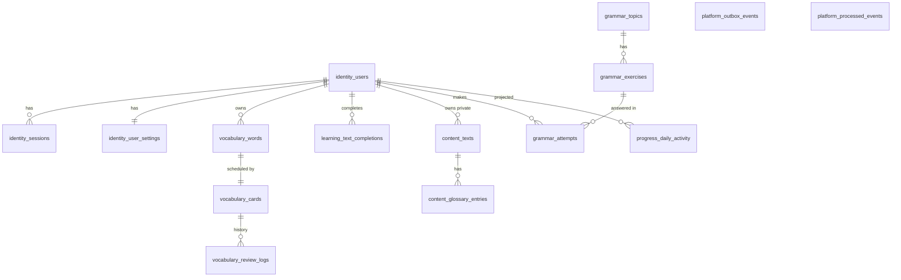
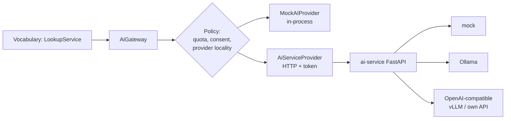
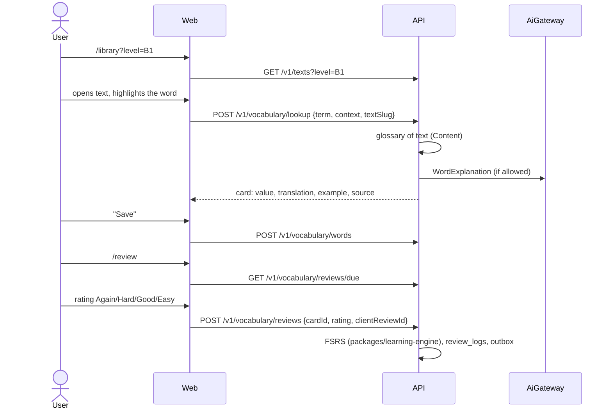

# Architecture of Open English Learning Platform

> Project working name — **Open English Learning Platform** (repository `LingoUp`, npm-scope `@lingoup/*`).
> This document describes the target architecture and the current state of implementation. Anything that is not yet implemented is explicitly marked.

## 1. Architectural Style

**Modular Monolith + Event-Driven Architecture + Independent AI Services.**

| Principle                                      | How it is implemented                                                                                                                                                                                 |
| ---------------------------------------------- | ----------------------------------------------------------------------------------------------------------------------------------------------------------------------------------------------------- |
| Modular backend with strict boundaries         | NestJS modules in `apps/api/src/modules/*`, each with its own public API (`index.ts`) and own PostgreSQL schema. Boundaries are checked by architectural test (`apps/api/test/architecture.test.ts`). |
| Minimal coupling                               | Modules communicate through public services (synchronously) or through domain events (asynchronously). Direct access to other tables is prohibited.                                                   |
| Gradual extraction into microservices          | Each module has its own database schema, its own events, and contracts in `packages/contracts`. A module can be extracted by replacing in-process calls with HTTP and keeping the events.             |
| Independent scaling of AI and background tasks | `apps/worker` and `apps/ai-service` — separate processes and Docker images.                                                                                                                           |
| Stateless HTTP API                             | Session state is stored in PostgreSQL (opaque token), counter limits — in Valkey. Any API instance can process any request.                                                                           |
| Asynchronous processing of heavy operations    | Transactional Outbox → BullMQ → idempotent handlers in `apps/worker`.                                                                                                                                 |
| Self-hosted-first                              | Everything runs through Docker Compose without external paid services. AI by default is `MockAIProvider`, GPU is not needed.                                                                          |

Deliberately excluded from the first stage: microservices, Kubernetes, Kafka, a separate database per module and a service mesh. See [ADR-0001](docs/adr/0001-modular-monolith.md).

## 2. System Context



## 3. Containers and Processes

| Process      | Purpose                                                                                                                            | Scaling                                         |
| ------------ | ---------------------------------------------------------------------------------------------------------------------------------- | ----------------------------------------------- |
| `web`        | UI on Next.js (App Router). Proxy `/api/*` to API to have same-origin cookies.                                                     | Horizontal, stateless                           |
| `api`        | REST API, OpenAPI, authorization, synchronous business logic, writing to outbox.                                                   | Horizontal, stateless                           |
| `worker`     | Outbox relay (PostgreSQL → BullMQ) and event handlers (progress projections).                                                      | Horizontal; relay uses `FOR UPDATE SKIP LOCKED` |
| `ai-service` | Python/FastAPI: LLM adapters (mock, Ollama, OpenAI-compatible — suitable for vLLM and user APIs), validation of structured output. | Independent, based on inference load            |
| `postgres`   | Single source of truth. Image `pgvector/pgvector` — extension is available, but not enabled yet.                                   | Vertical, then read replicas                    |
| `valkey`     | BullMQ queues, rate limiting, AI quotas. Data in Valkey can be lost without losing business data.                                  | Vertical / Sentinel                             |
| `ollama`     | Optional local LLM (Compose profile `ollama`).                                                                                     | GPU nodes                                       |

## 4. Backend modules



Arrow means: "calls the public API of the module." There are no reverse dependencies or cycles.

| Module         | Status             | Responsibility                                                                                                                                                                                                                                                 | DB Schema           |
| -------------- | ------------------ | -------------------------------------------------------------------------------------------------------------------------------------------------------------------------------------------------------------------------------------------------------------- | ------------------- |
| **Identity**   | ✅ MVP             | Registration, login, sessions, profile, settings (including consent for external AI)                                                                                                                                                                           | `identity`          |
| **Content**    | ✅ MVP             | Text library, CEFR metadata, glossary, import from `content/`; personal AI texts of the user (visible only to the owner)                                                                                                                                       | `content`           |
| **Vocabulary** | ✅ MVP             | Personal dictionary, word context, FSRS cards, repetition history, lookup, gap-fill exercises (AI or saved examples), word images                                                                                                                              | `vocabulary`        |
| **Learning**   | 🟡 Partial         | Reading completion (`LessonCompleted`), generation of personal texts from the user's words, voice conversation with AI tutor, listening with questions. Learning sessions — later                                                                              | `learning`          |
| **Grammar**    | ✅ MVP             | Topics by levels: rule, examples, exercises (selection and input) with server-side checking and progress. Import from `content/grammar/`                                                                                                                       | `grammar`           |
| **Progress**   | 🟡 Partially       | Daily activity projection (from events), profile summary. Weakness analysis — later                                                                                                                                                                            | `progress`          |
| **AI Gateway** | 🟡 Partially       | Abstraction `AIProvider`, routing, timeouts (interactive and for generation), parallelism limit, retry, output validation, quotas, privacy. Tasks: `WordExplanation`, `ReadingTextGeneration`, `ExerciseGeneration`, `SpeakingTutor`; local speech recognition | — (Valkey)          |
| **Assessment** | ⏳ Not implemented | Skill testing, confidence level assessment                                                                                                                                                                                                                     | `assessment` (plan) |
| **Planner**    | ⏳ Not implemented | Goals, available time, adaptive plan                                                                                                                                                                                                                           | `planner` (plan)    |
| **Media**      | ⏳ Not implemented | Video, audio, subtitles                                                                                                                                                                                                                                        | `media` (plan)      |

### 4.1. Internal structure of the module

```text
modules/vocabulary/
├── domain/          # Pure rules and invariants. Without NestJS and DB.
├── application/     # Use cases (services), ports (repository interfaces).
├── infrastructure/  # Drizzle repositories and adapters.
├── http/            # Controllers, contract binding to HTTP.
├── vocabulary.module.ts
└── index.ts         # Public API module — the only thing that can be imported from outside.
```

Layers are not dogmatic: if the use case is trivial, the repository interface is not created (see the "no unnecessary abstractions" rule).

### 4.2. Boundary Rules (automatically checked)

1. A module file `X` can import from module `Y` only `modules/Y/index.ts`.
2. Module `X` can import a Drizzle schema only `@lingoup/database/schema/X` (and `platform` — only through `OutboxWriter`).
3. Packages in `packages/*` do not import applications from `apps/*`.

Test: `apps/api/test/architecture.test.ts`.

## 5. Data Ownership

One PostgreSQL database, **a separate schema per module**. Details — [ADR-0003](docs/adr/0003-postgres-schema-per-module.md).



| Schema       | Owner                                | Tables                                           |
| ------------ | ------------------------------------ | ------------------------------------------------ |
| `identity`   | Identity                             | `users`, `sessions`, `user_settings`             |
| `content`    | Content                              | `texts` (public and private), `glossary_entries` |
| `grammar`    | Grammar                              | `topics`, `exercises`, `attempts`                |
| `vocabulary` | Vocabulary                           | `words`, `cards`, `review_logs`, `word_images`   |
| `learning`   | Learning                             | `text_completions`                               |
| `progress`   | Progress (write — handler in worker) | `daily_activity`                                 |
| `platform`   | Platform (infrastructure)            | `outbox_events`, `processed_events`              |

Cross-schema foreign keys are allowed **only on `identity.users(id)`** with `ON DELETE CASCADE`: this enables complete deletion of personal data. Links to content (`source_text_id`) are stored without FK: a content module may move, and the context snapshot (suggestion, slug) is preserved in the glossary.

## 6. Events

Catalog and versions — in `packages/contracts/src/events`. Event converter:

```ts
{ id: uuid, type: "WordSaved", version: 1, occurredAt: ISO-8601, userId?: uuid, payload: {...} }
```

| Event                       | Version | Producer            | Consumers   | Status                            |
| --------------------------- | ------- | ------------------- | ----------- | --------------------------------- |
| `UserRegistered`            | 1       | Identity            | — (reserve) | ✅ published                      |
| `WordSaved`                 | 1       | Vocabulary          | Progress    | ✅                                |
| `VocabularyReviewCompleted` | 1       | Vocabulary          | Progress    | ✅                                |
| `LessonCompleted`           | 1       | Learning            | Progress    | ✅ (reading text)                 |
| `LessonStarted`             | 1       | Learning            | —           | 📄 contract, not published        |
| `ExerciseCompleted`         | 1       | Grammar, Vocabulary | Progress    | ✅ (grammar, vocabulary exercise) |
| `AssessmentCompleted`       | 1       | Assessment          | —           | 📄 contract, not published        |
| `SkillLevelUpdated`         | 1       | Progress            | —           | 📄 contract, not published        |
| `LearningPlanUpdated`       | 1       | Planner             | —           | 📄 contract, not published        |

### Transactional Outbox

```mermaid
sequenceDiagram
    participant C as Client
    participant API as API (Vocabulary)
    participant PG as PostgreSQL
    participant R as Worker: outbox relay
    participant Q as Valkey (BullMQ)
    participant H as Worker: handler for Progress

    C->>API: POST /v1/vocabulary/words
    API->>PG: BEGIN; INSERT words, cards; INSERT outbox_events; COMMIT
    API-->>C: 201 Created
    loop every OUTBOX_POLL_INTERVAL_MS
        R->>PG: SELECT ... FOR UPDATE SKIP LOCKED (published_at IS NULL)
        R->>Q: add(job, jobId = event.id)
        R->>PG: UPDATE published_at = now()
    end
    Q->>H: job(WordSaved)
    H->>PG: BEGIN; INSERT processed_events (ON CONFLICT DO NOTHING); UPSERT daily_activity; COMMIT
```

- Delivery guarantee — **at-least-once**. Duplicates are filtered at two levels: `jobId = event.id` in BullMQ and the table `platform.processed_events` (key `consumer + event_id`) in a single transaction with the projection update.
- Retry with exponential backoff is configured in BullMQ. After exhausting attempts, the task remains in the failed set for analysis.
- Everything that needs to be executed synchronously for the user immediately (word saving, FSRS calculation) is done synchronously. Only side effects (projections, in the future — exercise generation, notifications) go through the queue.

## 7. AI-architecture



- Task contracts are described in `packages/ai-sdk`. Implemented tasks include `WordExplanation`, `ReadingTextGeneration`, `ExerciseGeneration`, `SpeakingTutor`, listening lesson generation and `WritingAssessment` (level-aware email exchanges with corrections of the latest reply). Writing exchanges live in the current browser page; recent email pairs form bounded AI context. Local Whisper recognition and Piper listening narration have dedicated endpoints; vocabulary and teacher speech use the speech gateway. `GrammarExplanation` and `LearningRecommendation` remain unsupported task contracts.
- **Speech synthesis** (`SpeechGateway`, port `SpeechProvider`): `AiServiceSpeechProvider` — Microsoft Edge voices through ai-service (edge-tts, free), `AzureSpeechProvider` — Azure AI Speech directly from API. Audio is cached in Valkey, quota is shared with AI. A single word is sent to Microsoft without user consent, a sentence — only with consent; without a provider, the browser's voice works. See [ADR-0009](docs/adr/0009-pronunciation-azure-speech.md).
- Generation is performed synchronously in an HTTP request with a separate timeout `AI_GENERATION_TIMEOUT_MS` and is not repeated on error; if AI is unavailable, the word-based exercise is built from saved examples. See [ADR-0008](docs/adr/0008-grammar-and-ai-practice.md).
- `AiGateway` does not know about models: it selects the provider by `AI_PROVIDER`, applies the timeout (`AbortSignal.timeout`), parallelism semaphore, retry only for idempotent tasks, validates the response with a Zod schema, and tracks the user's daily quota in Valkey.
- **Privacy:** the provider declares `dataLocality: "local" | "external"`. User text is sent to an external provider only if the administrator has allowed it (`AI_ALLOW_EXTERNAL=true`) **and** the user has given consent (`user_settings.ai_data_sharing`). Otherwise, only the text glossary is used, without AI.
- AI endpoints are not public: a session is required, rate limit applies. ai-service accepts only requests with `AI_SERVICE_TOKEN`.
- Streaming: **not implemented**. It is needed for conversational practice and detailed explanations; it is not justified in `WordExplanation` (the response is short and structured).

## 8. MVP Scenario: Interactive Reading + Personal Vocabulary



Reviews are idempotent: the client sends `clientReviewId` (UUID), and resubmitting does not create a second record.

## 9. Security

| Requirement       | Implementation                                                                                                                                                                                                         |
| ----------------- | ---------------------------------------------------------------------------------------------------------------------------------------------------------------------------------------------------------------------- |
| Authorization     | Email + password, hash Argon2id (`@node-rs/argon2`). Opaque session token (256 bits) in `HttpOnly; SameSite=Lax` cookie, stored only SHA-256 token in the database.                                                    |
| CSRF              | `SameSite=Lax` and check `Origin` for all mutating requests (`ALLOWED_ORIGINS`).                                                                                                                                       |
| Access Rights     | All requests to user data are filtered by `user_id` from the session at the repository level.                                                                                                                          |
| Validation        | Zod schemas from `packages/contracts` on API input; AI responses are also validated.                                                                                                                                   |
| Rate Limiting     | `@nestjs/throttler` with storage in Valkey; key — client IP (IPv6 is grouped by /64), separate limits for auth and AI-lookup. Additional: no more than 10 failed attempts per 15 minutes per account regardless of IP. |
| Request Size      | `bodyLimit` Fastify (default 64 KB), field length restrictions in schemas.                                                                                                                                             |
| HTML/Markdown     | Texts are stored as plain paragraphs; import rejects HTML. React renders only text nodes, without `dangerouslySetInnerHTML`.                                                                                           |
| Logs              | Pino with `redact` for `authorization`, `cookie`, passwords and email. Request bodies are not logged; values of query parameters are removed from database errors (`toSafeError`).                                     |
| Secrets           | Only environment variables; `.env` in `.gitignore`; in the repository — `.env.example`. In production services refuse to start with placeholders `change-me`.                                                          |
| Containers        | Non-privileged users, `no-new-privileges`, `cap_drop: ALL`; only ports on `127.0.0.1` are published outwardly.                                                                                                         |
| Redirects         | After login, only relative paths of the same origin are allowed (protection against open redirect).                                                                                                                    |
| Headers           | `@fastify/helmet` in API; security headers in Next.js.                                                                                                                                                                 |
| Health / shutdown | `/health/live`, `/health/ready` (PostgreSQL + Valkey); `enableShutdownHooks` in API, handling `SIGTERM` in worker.                                                                                                     |
| Personal data     | `GET /v1/me/export` (JSON export) and `DELETE /v1/me` (cascade deletion).                                                                                                                                              |

## 10. Technology stack

| Layer                | Technologies                                                                                   |
| -------------------- | ---------------------------------------------------------------------------------------------- |
| Monorepo             | pnpm 12 workspaces, Turborepo 2                                                                |
| Frontend             | Next.js 16, React 19, TypeScript 6, Tailwind CSS 4, TanStack Query 5                           |
| Backend              | NestJS 12 (ESM), Fastify 5, Zod 4, OpenAPI (`@nestjs/swagger`)                                 |
| Database             | PostgreSQL 18 (image with pgvector), Drizzle ORM 0.45, drizzle-kit (versioned SQL migrations)  |
| Queues / cache       | Valkey 9, BullMQ 6, ioredis 6                                                                  |
| Interval repetitions | FSRS through `ts-fsrs` (MIT)                                                                   |
| AI                   | Python 3.14, FastAPI, Pydantic 2, httpx; Ollama (optional)                                     |
| Quality              | ESLint 9 + typescript-eslint (strictTypeChecked), Prettier, Vitest 5, Playwright, Ruff, Pytest |
| Infrastructure       | Docker, Docker Compose, GitHub Actions                                                         |

Reason for version selection — [ADR-0002](docs/adr/0002-technology-stack.md).

## 11. Observability

- ✅ Structured JSON logs (pino) with request id.
- ✅ Health checks.
- ⏳ OpenTelemetry (traces API → worker → ai-service) — planned, see [ROADMAP.md](ROADMAP.md).
- ⏳ Prometheus / Grafana — directory `infra/monitoring` is reserved.

## 12. Technical debt and MVP limitations

Current list — in [docs/architecture/tech-debt.md](docs/architecture/tech-debt.md).
