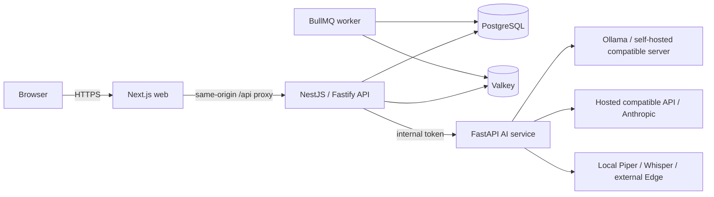

# LingoUp architecture

Reviewed: 2026-11-01 against the current checkout. LingoUp is a self-hosted English-learning application. This document describes implemented components; future work is listed in the [roadmap](ROADMAP.md) and [known limitations](docs/architecture/tech-debt.md).

## 1. Architectural style

The backend is a modular NestJS monolith with domain events, a separate worker and a separate Python AI service. Learning records live in PostgreSQL. Valkey holds queues, rate limits, quotas, speech cache and temporary learning sessions. Core reading, grammar, vocabulary and review work without a real AI model.

Heavy model generation is currently synchronous HTTP work. The background worker handles event delivery/projections and maintenance; it is not a general lesson-generation queue.

## 2. System context

The browser communicates through the web proxy rather than directly with model providers. Azure speech is a separate API-side adapter. YouTube/publisher embeds and user-opened external links have their own browser connections. Local video/subtitle files are handled in the browser.

## 3. Containers and processes

| Component  | Responsibility                                                                            |
| ---------- | ----------------------------------------------------------------------------------------- |
| web        | Next.js App Router, English UI, same-origin API proxy and browser media controls          |
| api        | Sessions, authorization, REST contracts, learning operations, AI policy and outbox writes |
| worker     | Outbox relay, idempotent progress projections and event-table maintenance                 |
| ai-service | LLM adapters, structured output validation, recognition and voice synthesis               |
| postgres   | Durable learner accounts, content, learning records and event tables                      |
| valkey     | BullMQ, limits/quotas, audio cache and expiring listening/exam state                      |
| ollama     | Optional local language-model inference                                                   |
| bootstrap  | Easy-preset one-shot credential generation into private Docker volumes                    |
| migrate    | One-shot SQL migration and bundled content import                                         |

The original Compose preset uses environment configuration and optional AI/Ollama profiles. The easy preset includes browser installation, generates credentials and publishes only the loopback web port. They use separate project/volume sets; switching presets is not a data migration.

## 4. Backend modules

| Module       | Implemented responsibility                                                                                     | Storage                                          |
| ------------ | -------------------------------------------------------------------------------------------------------------- | ------------------------------------------------ |
| Identity     | Registration/login, learner sessions/settings, export/deletion                                                 | identity schema                                  |
| Content      | Public reading library, glossaries, imported content and owned generated texts                                 | content schema                                   |
| Vocabulary   | Manual add/edit/categories, lookup, images, card templates, FSRS reviews and gap practice                      | vocabulary schema; speech through gateway        |
| Grammar      | Topic reference, checked exercises, attempts and topic progress                                                | grammar schema                                   |
| Learning     | Reading completion/checks, generated texts, speaking, writing, listening, exams and next-practice selection    | learning schema plus temporary Valkey sessions   |
| Progress     | Activity, six skill rewards, daily plan/development summary, focus time, weekly reports and mistake journal    | progress schema                                  |
| AI Gateway   | Model task policy, provider routing, validation, quotas/timeouts and speech cache/coalescing                   | Valkey; no owned SQL schema                      |
| Installation | Separate operator login, shared runtime settings, hardware checks, provider tests/downloads and voice previews | private filesystem/volume; no learner SQL schema |

Daily guidance, exam practice and video playback already exist within these modules. Separate generalized Assessment, Planner and Media backend modules have not been extracted or implemented as standalone services.

### 4.1. Module structure

Modules generally use domain, application, infrastructure and http folders, with index.ts as the public cross-module API. The small Installation module keeps its controller/service/hardware helpers together. Introduce abstractions when they clarify an actual boundary.

### 4.2. Boundary rules

The architecture test in apps/api/test/architecture.test.ts checks cross-module imports, schema ownership, platform dependencies and cycles. Packages must not depend on applications. Changes adding modules or storage ownership must keep this test's metadata current.

## 5. Data ownership and lifetime

| Storage             | Records                                                                                                  |
| ------------------- | -------------------------------------------------------------------------------------------------------- |
| identity            | users, sessions and user_settings, including native language, daily goal and card display settings       |
| content             | texts and glossary_entries                                                                               |
| vocabulary          | words, cards, review_logs and word_images                                                                |
| grammar             | topics, exercises and attempts                                                                           |
| learning            | text_completions and reading_checks                                                                      |
| progress            | daily_activity, skill_rewards, focus_time and mistake_entries                                            |
| platform            | outbox_events and processed_events                                                                       |
| Valkey              | Jobs/limits/quotas, shared per-voice speech cache, temporary listening lessons and exam sessions/results |
| Installation volume | owner.json password/signing state and runtime.json shared provider/settings state                        |
| Model volumes       | Downloaded Ollama, Whisper and Piper artifacts                                                           |

Account deletion cascades through owned SQL records and removes user-linked outbox data. Export aggregates supported durable account records; it does not export installation secrets.

Writing exchanges and speaking context live in the current browser page. Listening/exam state expires after 24 hours. Those are different persistence guarantees from saved vocabulary, reading checks, grammar attempts and the mistake journal.

## 6. Events and progress

Business changes and corresponding events are committed together through OutboxWriter. The relay selects unpublished rows using FOR UPDATE SKIP LOCKED, puts them into BullMQ with event-id job IDs, and marks them published. Consumers use platform.processed_events in the same transaction as projection updates.

| Event                                                                      | Current use                                           |
| -------------------------------------------------------------------------- | ----------------------------------------------------- |
| UserRegistered                                                             | Published by Identity                                 |
| WordSaved                                                                  | Vocabulary activity projection                        |
| VocabularyReviewCompleted                                                  | Review activity and vocabulary progress               |
| LessonCompleted                                                            | Reading completion                                    |
| ExerciseCompleted                                                          | Grammar/vocabulary exercise completion                |
| PracticeCompleted                                                          | Skill practice rewards, including learning activities |
| LessonStarted, AssessmentCompleted, SkillLevelUpdated, LearningPlanUpdated | Reserved contracts; no current producers              |

Delivery is at least once with idempotent consumers. Published queue jobs are retried eight times with exponential backoff; failed jobs are retained for seven days. Cleanup limits event-table retention.

Valkey loss is not equivalent to an ordinary worker restart: published-but-unprocessed jobs are not automatically selected by the unpublished-only relay. Durable SQL records remain, but queue reconciliation/projection repair needs operator work. See [operations](docs/operations.md#backup-and-restoration).

Skill XP/player levels are activity rewards, not calibrated CEFR estimates. Focus-time synchronization keeps cumulative totals without awarding XP just for elapsed time. Daily-plan/weekly logic uses Europe/Kyiv; the older daily activity projection retains UTC buckets.

## 7. AI and speech architecture

AiGateway applies task support, provider locality, operator permission, learner consent, quota, concurrency and task-specific deadlines. Only retry-safe tasks are retried. Task input/output contracts are in packages/ai-sdk; Python validates structured model output independently.

Adapters support mock demonstration output, local Ollama, OpenAI-compatible servers and native Anthropic Messages. OpenAI/GPT and DeepSeek use compatible endpoints. A configured provider still needs to support the required structured output reliably.

Implemented learning tasks include word explanations, text/exercise generation, reading checks, speaking, writing, listening generation and exam assessment. GrammarExplanation and LearningRecommendation remain reserved unsupported contracts. Whisper recognition and speech synthesis have dedicated service implementations.

### Voice path

SpeechGateway uses a provider-specific port: Azure directly, or Edge/Piper through the internal AI service. It checks consent before cache access, hashes normalized text into a provider/voice key, combines matching in-flight requests and charges quota only on uncached generation.

Browser speaker controls keep up to 24 media clips scoped by learner/privacy/voice revision. Selected-word preparation and hover/focus preparation are allowed for local voices, or Edge with learner external-sharing consent; paid Azure is not called speculatively. Voice metadata has a short lifetime, and sign-out/installation changes clear this tab's prepared cache.

Explicit external term playback has a separate policy from private sentence playback: sentences require consent; dictionary terms do not. External LLM consent does not implicitly configure a speech provider. Local Piper does not silently fall back to external Edge. Browser fallback restricts private sentences to on-device voices.

The first local model/voice load or external synthesis can still be slow. Caching does not guarantee instant new speech, and conversation responses are not streamed.

## 8. Frontend behavior

TanStack Query manages server data. Original reading text keeps its glossary/source links and keyboard selection behavior. Shared site translation uses DOM ranges and event delegation rather than rewriting React-owned text nodes. Editable fields require explicit selection; credentials, controls and hidden content are excluded.

Pronunciation and teacher-call playback use separate client helpers so call cancellation can stop obsolete speech. Native browser dialog/popup behavior and responsive layouts are covered by targeted desktop/mobile scenarios, not a complete accessibility certification.

## 9. Security

- Learner passwords use Argon2id; opaque session tokens are hashed in PostgreSQL and sent as HttpOnly, SameSite=Lax cookies.
- Mutating browser requests require an allowed Origin. Public deployments need HTTPS, secure cookies and a correctly trusted/replacing outer proxy.
- Owned data is filtered by the authenticated account; AI responses and API inputs use explicit schemas.
- Rate limits and account login protection supplement quotas. Upload and recognition routes have specific binary size limits.
- The installation login is separate: scrypt password state, signed HttpOnly SameSite=Strict cookie and a 30-minute session. It grants shared configuration access, not learner-account access.
- API keys are write-only in setup responses but readable by authorized services from runtime configuration. Back up those files as secrets.
- Containers use restricted users/capabilities where supported; the easy preset has no Docker socket mount.
- Pino redacts known credential fields and does not log request bodies. Request URLs can still include query parameters, including pronunciation text; operational logs need appropriate access and retention controls.
- Email verification/recovery, audit logs and device management remain incomplete. See [known limitations](docs/architecture/tech-debt.md).

## 10. Technology stack

The repository uses Node.js 24, pnpm 12, TypeScript 6, Next.js 16/React 19, NestJS/Fastify, Zod, Drizzle/PostgreSQL, Valkey/BullMQ, Python/FastAPI, Ollama, Whisper and Piper. Exact versions live in package manifests, the lockfile, Python requirements and Dockerfiles.

## 11. Deployment and observability

JSON logs, request identifiers and readiness/liveness endpoints are implemented. OpenTelemetry, metrics dashboards and failed-queue alerts remain planned.

Learner HTTP sessions are shared through PostgreSQL. Browser installation settings, downloads and restart coordination are designed for one installation, not an automatic multi-replica control plane. Horizontal deployment requires port/load-balancer overrides, shared configuration and coordinated rollout. Do not infer support from a bare Compose scale command.

## 12. Further documentation

- [Learner guide](docs/user-guide.md)
- [Installation, backups and recovery](docs/operations.md)
- [Models, voices and hardware](docs/setup-hardware.md)
- [API reference](docs/api/README.md)
- [Development and tests](docs/development.md)
- [Status and release criteria](docs/project-status.md)
- [Architecture decisions](docs/adr/README.md)
