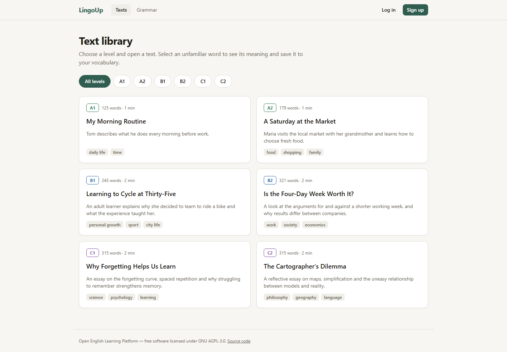
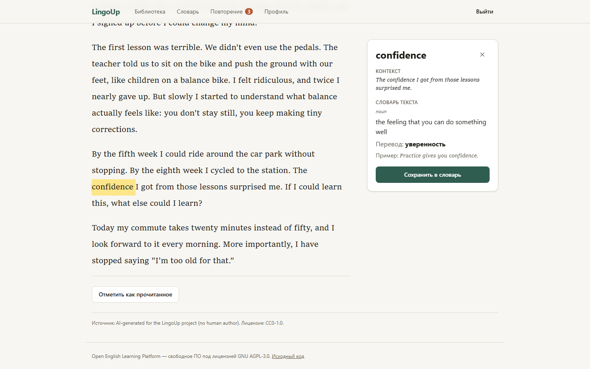
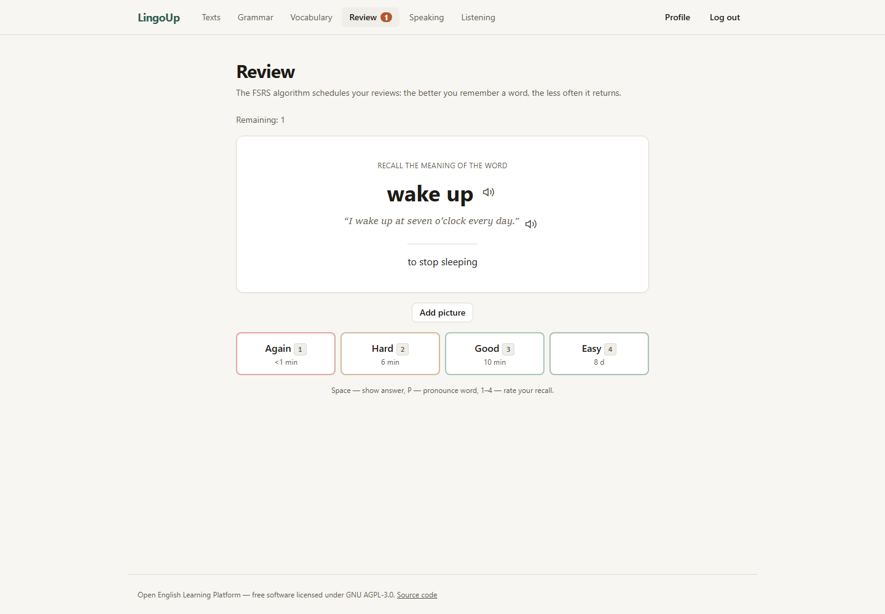

# Open English Learning Platform

> Рабочее название. Репозиторий: `LingoUp`.

Открытая self-hosted платформа для изучения английского языка: чтение, словарь с интервальными повторениями, а в перспективе — аудирование, разговорная практика, письмо, грамматика, тестирование уровня и AI-репетитор. Уровни сложности соответствуют CEFR (A1–C2). Базовый функционал работает **без AI**, а AI-модели подключаются как опциональные адаптеры (Ollama, vLLM, любой OpenAI-совместимый API).

## Статус

Реализован первый вертикальный срез **Interactive Reading + Personal Vocabulary**:

- библиотека текстов с фильтром по уровню A1–C2 (6 оригинальных демо-текстов);
- интерактивное чтение: выделение слова или фразы мышью, касанием или с клавиатуры;
- контекстная карточка: глоссарий текста (без AI), иначе — объяснение через AI Gateway (по умолчанию `MockAIProvider`);
- персональный словарь с контекстом, поиском и пагинацией;
- повторения по алгоритму **FSRS** с историей в PostgreSQL и идемпотентной отправкой оценок;
- профиль: прогресс, активность за 30 дней, настройки, экспорт и удаление персональных данных.

| Библиотека                                          | Карточка слова                                               | Повторение (FSRS)                               |
| --------------------------------------------------- | ------------------------------------------------------------ | ----------------------------------------------- |
|  |  |  |

На телефоне карточка открывается снизу: [скриншот](docs/screenshots/mobile-word-card.png).

Что ещё не реализовано — в [ROADMAP.md](ROADMAP.md) и [docs/architecture/tech-debt.md](docs/architecture/tech-debt.md).

## Быстрый старт (Docker)

Нужен только Docker с Compose v2 (Docker Desktop на Windows/macOS или Docker Engine на Linux). Платные сервисы и GPU не нужны.

```bash
git clone https://github.com/sen4ch/LingoUp.git && cd LingoUp

# 1. Секреты: создаёт .env со случайными паролями (нужен Node.js любой версии ≥ 18)
node scripts/init-env.mjs
#    без Node.js: cp .env.example .env и замените каждое значение change-me-… на случайную
#    строку (например, openssl rand -hex 24); одинаковые плейсхолдеры — одинаковыми значениями

# 2. Запуск (первая сборка образов занимает несколько минут)
docker compose up -d --build --wait
```

Откройте http://localhost:3000. При первом запуске сервис `migrate` применит миграции и импортирует демо-тексты. Сервисы не запустятся в production-режиме, если в `.env` остались плейсхолдеры `change-me`.

| Адрес                              | Что там                              |
| ---------------------------------- | ------------------------------------ |
| http://localhost:3000              | Веб-приложение                       |
| http://localhost:4000/docs         | Swagger UI (API)                     |
| http://localhost:4000/health/ready | Готовность API (PostgreSQL + Valkey) |

Опциональные профили:

```bash
docker compose --profile ai up -d        # + apps/ai-service (по умолчанию тоже mock)
docker compose --profile ollama up -d    # + локальный Ollama; затем AI_PROVIDER=ai-service, AI_BACKEND=ollama
```

Как подключить настоящую модель, описано в [docs/operations.md](docs/operations.md#подключение-ai).

## Локальная разработка

Требования: **Node.js 24 LTS** (см. `.nvmrc`), **pnpm 12.15.0** (закреплён в `packageManager`), Docker.

```bash
npm install --global pnpm@12.15.0       # или: corepack enable (если corepack есть в вашем Node.js)
pnpm setup:env                          # создаёт .env со случайными секретами
docker compose up -d postgres valkey    # инфраструктура
pnpm install
pnpm build                              # собрать внутренние пакеты
pnpm db:migrate                         # миграции
pnpm content:import                     # демо-тексты
pnpm dev                                # web :3000, api :4000, worker
```

Подробнее, в том числе про тесты, — в [docs/development.md](docs/development.md).

## Основные команды

| Команда                                | Что делает                                   |
| -------------------------------------- | -------------------------------------------- |
| `pnpm dev`                             | Запуск web, api и worker в режиме разработки |
| `pnpm build`                           | Сборка всех пакетов и приложений (Turborepo) |
| `pnpm lint` / `pnpm typecheck`         | ESLint и проверка типов                      |
| `pnpm test`                            | Unit-тесты и архитектурные тесты             |
| `pnpm test:integration`                | Интеграционные тесты на PostgreSQL и Valkey  |
| `pnpm test:e2e`                        | Playwright E2E против запущенного стека      |
| `pnpm smoke:api`                       | Smoke-тест API всего сценария                |
| `pnpm db:generate` / `pnpm db:migrate` | Генерация и применение миграций              |
| `pnpm content:import`                  | Идемпотентный импорт текстов из `content/`   |
| `pnpm openapi:export`                  | Экспорт OpenAPI в `docs/api/openapi.json`    |

## Структура

```text
apps/
  web/          Next.js 16 — интерфейс, прокси /api → API
  api/          NestJS 12 + Fastify — модульный монолит (REST, OpenAPI)
  worker/       BullMQ — outbox relay и обработчики событий
  ai-service/   Python FastAPI — адаптеры LLM (mock / Ollama / OpenAI-совместимый)
packages/
  contracts/        Zod-схемы API и версионированные контракты событий
  database/         Drizzle-схемы (схема PostgreSQL на модуль), миграции
  learning-engine/  FSRS и обработка текста (без I/O)
  ai-sdk/           Контракты AI-задач и клиент ai-service
  ui/               Дизайн-система (Tailwind 4)
  shared/           Конфигурация окружения, правила логирования
content/        Учебные тексты (отдельная лицензия)
infra/          Dockerfile-ы; monitoring/ зарезервирован
docs/           Архитектура, ADR, API, эксплуатация
```

## Документация

- [ARCHITECTURE.md](ARCHITECTURE.md) — архитектура, модули, события, безопасность, диаграммы
- [docs/adr/](docs/adr/README.md) — архитектурные решения
- [docs/development.md](docs/development.md) — разработка и тестирование
- [docs/operations.md](docs/operations.md) — деплой, секреты, бэкапы, восстановление, AI
- [docs/api/README.md](docs/api/README.md) — API и OpenAPI
- [docs/architecture/tech-debt.md](docs/architecture/tech-debt.md) — технический долг и ограничения
- [CONTRIBUTING.md](CONTRIBUTING.md), [SECURITY.md](SECURITY.md), [CODE_OF_CONDUCT.md](CODE_OF_CONDUCT.md)

## Лицензия

Исходный код распространяется по лицензии **GNU Affero General Public License v3.0** (`AGPL-3.0-only`), полный текст — в [LICENSE](LICENSE). Обоснование — в [ADR-0007](docs/adr/0007-license-proposal.md).

Если вы разворачиваете **изменённую** версию платформы и даёте к ней доступ по сети, AGPL требует предоставить пользователям исходный код этой версии. Для этого в интерфейсе есть ссылка «Исходный код»; укажите в `SOURCE_CODE_URL` адрес своего репозитория.

Что лицензируется отдельно:

- **Учебный контент** (`content/`) — лицензия указана в каждом файле; см. [content/README.md](content/README.md).
- **Зависимости** — по своим лицензиям (MIT, Apache-2.0, BSD, ISC, MPL-2.0, LGPL-3.0 у libvips в `sharp`); все совместимы с AGPL-3.0.
- **AI-модели** в репозиторий не входят; лицензию выбранной модели (например, в Ollama) проверяйте отдельно.
