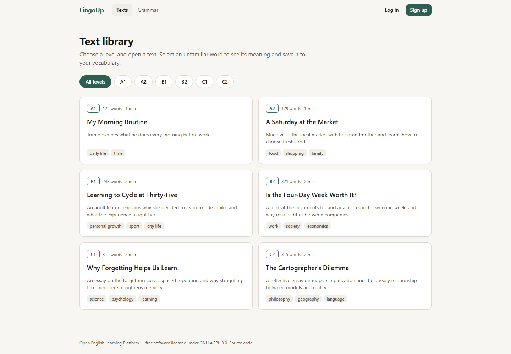
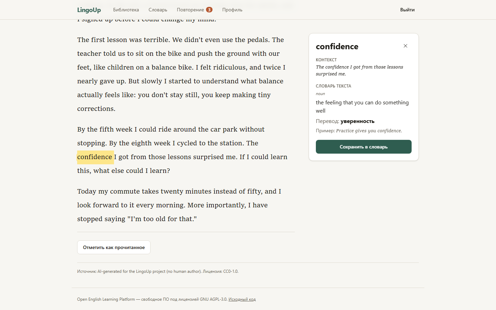
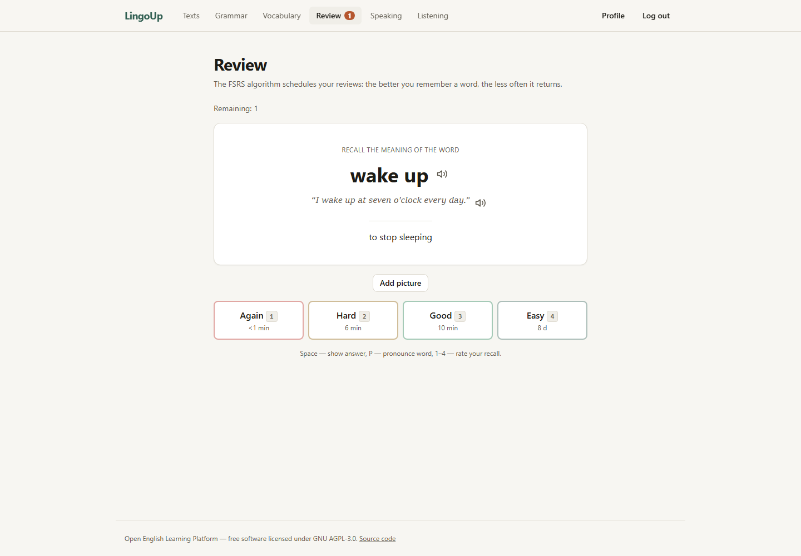

# LingoUp

An open, self-hosted platform for learning English at CEFR levels A1–C2. Reading, grammar, vocabulary and spaced repetition work without AI. Optional models add personalized texts, exercises, voice conversations and listening lessons through Ollama or an OpenAI-compatible service.

The interface, bundled learning materials and project documentation are in English. You can choose a native language for AI vocabulary translations in your profile.

**Current status:** functional self-hosted MVP for personal use and a controlled pilot. Public-launch hardening remains. See [project status and release criteria](docs/project-status.md), the [learner guide](docs/user-guide.md), and [known limitations](docs/architecture/tech-debt.md). Documentation was reviewed against the current checkout on 2026-11-01; this does not imply a tagged release or a complete fresh regression run.

## Features

- **Reading:** six original demo texts, level filters, and word or phrase selection with mouse, touch or keyboard.
- **Vocabulary:** contextual word cards, source-text glossaries, optional AI explanations, manual word creation/editing, categories, saved examples, search, pictures and pronunciation. Card settings support English-first or translation-first recall and configurable answer details.
- **Pronunciation:** browser, local Piper medium/high, Edge and environment-configured Azure voices. Server caching and identical-request coalescing avoid duplicate synthesis; a bounded browser cache speeds replay. Selected-word preparation respects privacy/provider settings. A first uncached request can still take seconds.
- **Review:** FSRS scheduling, persistent review history, keyboard controls and safe retry of ratings.
- **Grammar:** 100 topics and 420 exercises across A1–C2, explanations, examples and saved progress.
- **Word translation across the site:** click rendered words or select a short phrase in any section for a contextual explanation, translation into your profile language, pronunciation and vocabulary saving. Writing fields offer an explicit selection action / Alt+T; passwords and credential fields are excluded. The original reader retains its glossary and source links. Translation uses the configured AI provider and existing consent/quota rules; the interface stays English.
- **Reading comprehension:** optional 3–5 question checks after a text, saved account results, explanations and exact supporting quotes. The six bundled texts have prepared checks; new/private texts use the configured AI provider and its sharing/usage policy. Passing at 60% marks the text read through the existing one-time Reading XP flow. An optional ungraded retelling draft is kept in the current browser tab.
- **My texts:** private AI texts using all your saved words or selected words; vocabulary gap exercises with a fallback to saved examples.
- **Speaking:** voice calls with an English-only AI teacher, local speech recognition, pause and interrupt controls, and conversation context.
- **Writing:** email exchanges with an AI pen pal at A1–C2, a full corrected text and level-adapted teaching feedback. A1/A2/B1/B2 initially show up to 3/4/5/6 explanations; further corrections expand on demand. Red spelling, yellow grammar and blue optional suggestions link to explanations. Exchanges last for the current page session.
- **Exams:** original short IELTS Academic-style Listening, Reading, Writing and Speaking practice. Completion shows a practice score out of 100, objective question results and AI writing/language estimates. It is not an official IELTS result; pronunciation and live fluency are not scored from transcripts. Exam sessions and results expire after 24 hours.
- **Listening:** measured 3–5 minute audio with level-appropriate questions and feedback; a separate section for films and series through publisher videos, YouTube links or local files with subtitles.
- **Profile:** a daily study plan matched to a saved 5–240 minute goal, six skills with earned XP, skill/player levels, 30-day activity, settings, personal data export and account deletion. Game levels reward practice independently of CEFR proficiency.
- **Continue learning:** a button in Profile, the library and reading pages rechecks the current daily plan before opening its next unfinished activity. It chooses unread level-appropriate public/owned texts, unfinished grammar topics, due reviews or vocabulary practice, and starts the skill timer while preserving remaining time. Activities without materials are skipped with explanations; completed plans and setup needs are shown explicitly. Selecting a step does not generate AI content or complete activities.
- **Weekly summary:** Monday–Sunday reports in Kyiv time, with earlier-week navigation, skill/player XP gains, active days, timer-recorded time, saved words, completed reading, common saved errors and a concrete next goal. Timer totals sync to the account cumulatively, so retries do not duplicate time; time alone grants no XP. Unrecorded time before this update cannot be recovered. Historical reports compare against the current daily time goal, and mistake review status reflects the journal now.
- **Mistake journal:** account-saved Writing, Grammar and Speaking corrections with source/type/status filters, rules and examples, optional hidden answers, and understood/reopen actions. Existing grammar mistakes are imported; new AI corrections are captured after assessment, excluding demo feedback. Entries are included in personal data export and account deletion.

AI features need a configured provider. `MockAIProvider` produces explicitly labeled demonstration output. Speaking also needs speech recognition and an English voice; listening narration uses local Piper. See [operations](docs/operations.md) for setup and limits.

| Library                                       | Word card                                                  | FSRS review                                       |
| --------------------------------------------- | ---------------------------------------------------------- | ------------------------------------------------- |
|  |  |  |

On phones, word cards open as a bottom sheet: [mobile screenshot](docs/screenshots/mobile-word-card.png).

See the [roadmap](ROADMAP.md) and [known limitations](docs/architecture/tech-debt.md) for unfinished work.

## Quick start with Docker

Install Docker with Compose v2: Docker Desktop on Windows/macOS or Docker Engine on Linux. Paid services and a GPU are optional.

```bash
git clone https://github.com/sen4ch/LingoUp.git
cd LingoUp

# No .env, Node.js or API keys required. The first build takes several minutes.
docker compose -f compose.easy.yml up -d --build --wait
```

Open **http://localhost:3000**. The browser opens the setup wizard:

1. Create an installation password, separate from your learner account.
2. Choose core learning without AI, local Ollama, or a hosted/custom API. Presets cover OpenAI/GPT, Anthropic/Claude, DeepSeek and other compatible endpoints. Test connections and download an Ollama model directly in the wizard.
3. Review and finish. Services apply changes automatically; then create a learner account or log in.

Database/cache passwords and the internal service token are generated once and retained in Docker volumes. The stack includes the AI service and an empty CPU Ollama server; a language model is downloaded only when requested. No paid service is needed for core learning. Optional picture search, online pronunciation and local speech recognition are also configured in the browser.

Return to **Installation settings** in the footer to change settings. Saved API keys are write-only in the interface. External AI needs both the operator's permission and each learner's consent.

Step 2 includes OpenAI/GPT, Claude, DeepSeek and custom API presets, local model requirements, a Docker-aware hardware check, editable recommendations, and local lightweight/enhanced voice previews. See [hardware and voice guidance](docs/setup-hardware.md) for budgets, GPU support and detection limits.

```bash
docker compose -f compose.easy.yml stop                 # Stop, preserving data
docker compose -f compose.easy.yml up -d --wait         # Start again
docker compose -f compose.easy.yml up -d --build --wait # Update after pulling changes
```

This local preset publishes only the web application, on loopback. Complete setup locally before exposing an installation to other people. For GPU acceleration, deployment options, backups and password recovery see [operations](docs/operations.md#browser-installation).

### Existing installations and environment configuration

Keep using your existing `docker-compose.yml` commands and volumes. The easy preset uses a separate `lingoup-easy` project and does not migrate or reuse an existing installation's data. Both presets default to port 3000, so run one at a time or set a different `WEB_PORT`.

For a new environment-managed installation:

```bash
node scripts/init-env.mjs  # Requires Node.js 18+; never overwrites an existing .env
docker compose up -d --build --wait
```

Without Node.js, copy `.env.example` to `.env` and replace every `change-me-…` value with a random secret, for example from `openssl rand -hex 24`. Use the same value wherever the same placeholder appears. Production services reject unchanged placeholders. The `migrate` service applies database migrations and imports content before application services start.

The original preset can also offer `/setup`: set `BROWSER_SETUP_ENABLED=true` and recreate the API/AI containers to opt in before exposing the installation. Browser administration is disabled by default in this environment-managed preset. Saved wizard choices override environment settings for AI, picture search and speech. Set the flag back to `false` to restore environment-only control. The original preset requires the optional AI/Ollama profiles below before these services can be used by the wizard.

| Address                            | Purpose                              |
| ---------------------------------- | ------------------------------------ |
| http://localhost:3000              | Web application                      |
| http://localhost:4000/docs         | Swagger UI                           |
| http://localhost:4000/health/ready | API readiness, PostgreSQL and Valkey |

Optional profiles:

```bash
docker compose --profile ai up -d      # Python AI service; its default backend is also mock
docker compose --profile ollama up -d  # Adds local Ollama
```

To use a real local model, configure `AI_PROVIDER=ai-service` and `AI_BACKEND=ollama`, download the model and set its name. Full instructions, including host-installed Ollama, are in [operations](docs/operations.md).

## Local development

Requirements: **Node.js 24 LTS** (`.nvmrc`), **pnpm 12.15.0** (`packageManager`) and Docker.

```bash
npm install --global pnpm@12.15.0
pnpm setup:env
docker compose up -d postgres valkey
pnpm install
pnpm build
pnpm db:migrate
pnpm content:import
pnpm dev
```

This starts the web app on port 3000, the API on port 4000 and the background worker. See [development](docs/development.md) for test setup and contribution workflows.

## Commands

| Command                                | Purpose                                               |
| -------------------------------------- | ----------------------------------------------------- |
| `pnpm dev`                             | Start development applications                        |
| `pnpm build`                           | Build all packages and applications through Turborepo |
| `pnpm lint` / `pnpm typecheck`         | Run ESLint and TypeScript checks                      |
| `pnpm test`                            | Unit and architecture tests                           |
| `pnpm test:integration`                | Integration tests with PostgreSQL and Valkey          |
| `pnpm test:e2e`                        | Playwright tests against the running stack            |
| `pnpm smoke:api`                       | End-to-end API smoke test                             |
| `pnpm db:generate` / `pnpm db:migrate` | Generate and apply migrations                         |
| `pnpm content:import`                  | Idempotently import bundled texts and grammar         |
| `pnpm openapi:export`                  | Export `docs/api/openapi.json`                        |

## Repository layout

```text
apps/
  web/              Next.js 16 UI and same-origin API proxy
  api/              NestJS 12 + Fastify modular REST API
  worker/           BullMQ outbox relay and event handlers
  ai-service/       FastAPI model adapters, recognition and narration
packages/
  contracts/        Zod API schemas and versioned event contracts
  database/         Drizzle schemas and migrations
  learning-engine/  Pure FSRS and text-processing logic
  ai-sdk/           AI task contracts and service client
  ui/               Tailwind 4 design system
  shared/           Environment configuration and logging rules
content/            Separately licensed learning materials
infra/              Dockerfiles and reserved monitoring configuration
docs/               Architecture, ADRs, API and operations
```

## Documentation

- [Architecture](ARCHITECTURE.md): module boundaries, events, security and diagrams.
- [Learner guide](docs/user-guide.md): daily workflows, vocabulary cards, translation and progress.
- [Project status](docs/project-status.md): available scope, verification limits and public-launch criteria.
- [Architecture decisions](docs/adr/README.md).
- [Development and testing](docs/development.md).
- [Operations](docs/operations.md): deployment, secrets, backups, recovery and AI.
- [API reference](docs/api/README.md) and [OpenAPI](docs/api/openapi.json).
- [Technical debt](docs/architecture/tech-debt.md).
- [Contributing](CONTRIBUTING.md), [security](SECURITY.md) and [code of conduct](CODE_OF_CONDUCT.md).
- [Learning content format and licensing](content/README.md).

## License

Source code is licensed under **GNU Affero General Public License v3.0** (`AGPL-3.0-only`); see [LICENSE](LICENSE) and [ADR-0007](docs/adr/0007-license-proposal.md).

If you deploy a modified version for users over a network, AGPL requires access to the corresponding source code. Set `SOURCE_CODE_URL` to your repository so the application's **Source code** link points to your version.

Learning content is licensed separately in each file. Human-authored or substantially human-edited content uses CC BY 4.0 under project policy; fully AI-generated demo materials use CC0-1.0 without claiming human authorship or exclusive rights. See [content/README.md](content/README.md).

Dependencies retain their own licenses. These include MIT, Apache-2.0, BSD, ISC, MPL-2.0, LGPL-3.0 for libvips in `sharp` and `edge-tts`, and GPL-3.0 for Piper. Model weights are not included in this repository; check each model and voice license separately.
